<h1 align="center">Hey 👋 What's Up?</h1>

```python

class AhmadRifai:
    def __init__(self):
        # Personal Information
        self.name = "Ahmad Rifai"
        self.role = "Frontend & Mobile Developer"
        self.location = "Bogor, Jawa Barat"
        self.background = "Developer"
        self.email = "ahmadrifai808@gmail.com"
        self.mode = True

        # Specialization
        self.specialization = [
            "TypeScript",
            "Next.js",
            "Laravel",
            "Tailwind CSS",
            "Python",
            "Flutter",
            "Firebase",
            "PostgreSQL",
            "MySQL",
            "Go"
        ]

        # Current Mission
        self.current_mission = (
            "Membangun proyek web dan mobile modern"
        )

        # Technology Stack
        self.tech_stack = {
            "frontend": [
                "Next.js",
                "Flutter",
                "Tailwind CSS"
            ],
            "backend": [
                "Laravel",
                "Go",
                "Python"
            ],
            "database": [
                "PostgreSQL",
                "MySQL",
                "Firebase"
            ],
            "tools": [
                "Git",
                "Docker",
                "Figma"
            ]
        }

        # Services
        self.available_services = [
            "Web Development",
            "Mobile Development",
            "IT Consulting"
        ]

        # Social Media & Portfolio
        self.social_links = {
            "github": "",
            "linkedin": "",
            "portfolio": ""
        }

    def get_status(self):
      
    def get_profile(self):
        return {
            "name": self.name,
            "role": self.role,
            "location": self.location,
            "background": self.background,
            "email": self.email,
            "status": self.get_status(),
            "current_mission": self.current_mission
        }      

# Initialize Developer
developer = AhmadRifai()

# Display Profile
developer.display_profile()

```

###

<div align="center">
  
  
  
  
  
  
  
  
  
  
  
  
  
  
  
  
  
  
  
</div>

###

<div align="center">
  <!-- Ganti URL di href sesuai profil media sosial Anda -->
  <a href="https://www.linkedin.com/in/ahmad-rifai2905" target="_blank" rel="noreferrer">
    
  </a>
  <a href="https://twitter.com/your-profile" target="_blank" rel="noreferrer">
    
  </a>
  <a href="https://discord.gg/your-invite" target="_blank" rel="noreferrer">
    
  </a>
  <a href="https://instagram.com/ahmad_rifa_1" target="_blank" rel="noreferrer">
    
  </a>
  <a href="https://wa.me/62895711580060?text=Halo%20saya%20Ahmad%20Rifai%20dari%20Bogor%2C%20mahasiswa%20programer" target="_blank" rel="noreferrer">
    
  </a>
</div>

###


<picture>
  <source media="(prefers-color-scheme: dark)" srcset="./output/pacman-contribution-graph-dark.svg">
  <source media="(prefers-color-scheme: light)" srcset="./output/pacman-contribution-graph.svg">
  
</picture>

###
